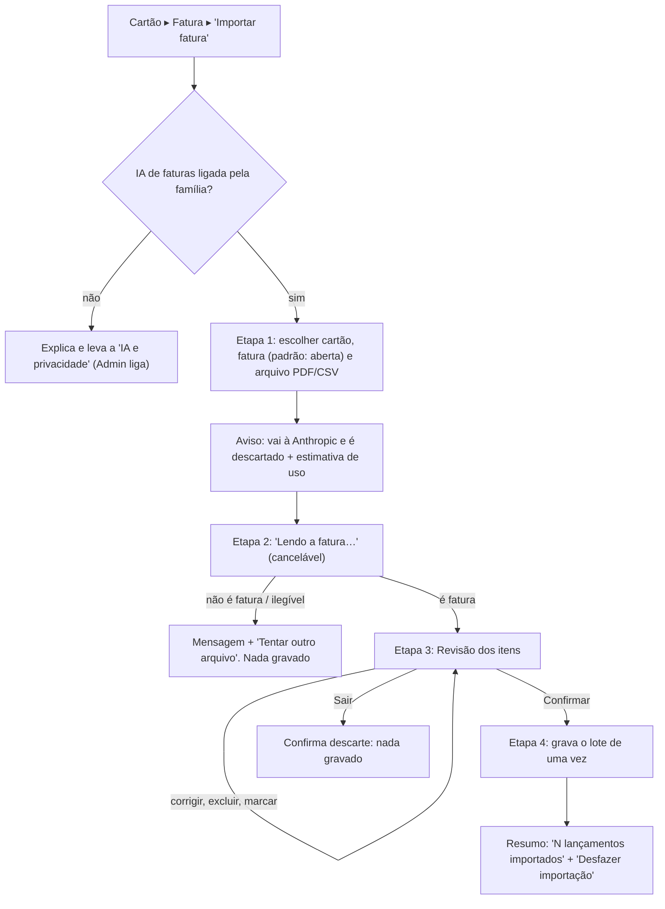

# FLUXO-015: Importar fatura de cartão por arquivo (R4-B, proposta)

- **Objetivo**: transformar a digitação mensal da fatura em uma **conferência de poucos minutos**, sem nunca gravar nada que a pessoa não tenha visto (RN15).
- **Rastreabilidade**: [NEED-026](../../stakeholder/needs/NEED-026-importacao-de-fatura-por-arquivo.md) · Histórias [US-066](../backlog/stories/US-066-enviar-fatura-e-validar-arquivo.md), [US-067](../backlog/stories/US-067-revisar-itens-extraidos-da-fatura.md), [US-068](../backlog/stories/US-068-confirmar-e-gravar-importacao.md), [US-069](../backlog/stories/US-069-reverter-importacao-em-lote.md) · [EN-004](../backlog/stories/EN-004-infra-llm-chave-do-app-e-teto-de-custo.md), [EN-005](../backlog/stories/EN-005-opt-in-de-privacidade-para-ia.md) · D-PO-59..63.

## Etapa 1: escolher
- Entrada pelo cartão (ação "Importar fatura" na fatura aberta). A fatura vem **selecionada pela aberta**; a pessoa pode trocar. Fatura paga não aparece como opção.
- Seletor de arquivo aceita **PDF e CSV**; outro formato mostra "Formato não aceito. Use PDF ou CSV".
- Antes de enviar: texto curto e visível "O arquivo será enviado à Anthropic para leitura e depois descartado" e a **estimativa de uso** (EN-004). Botão principal "Ler fatura".

## Etapa 2: leitura
- Indicador de progresso com texto ("Lendo a fatura…") e **Cancelar**. Não há tela vazia: se demorar, a mensagem muda ("Ainda lendo, faturas longas levam mais").
- Resultado negativo (não é fatura, ilegível, teto de IA atingido, provedor fora do ar) sempre com **saída clara** e a garantia "Nada foi gravado".
- Aviso não bloqueante quando o período/vencimento do arquivo não bate com a fatura escolhida (corrigir ou continuar).

## Etapa 3: revisão (a tela principal)
Hierarquia, de cima para baixo:
1. **Cabeçalho**: cartão, fatura, nome do arquivo.
2. **Rodapé fixo** (sempre visível): "Marcados: N · R$ X" × "Total do arquivo: R$ Y" e, se diferente, "Diferença de R$ Z" em destaque. Botão primário "Importar N lançamentos" (desabilitado se há item em "Precisa de atenção").
3. **Grupos** em lista rolável: **A lançar** (marcados), **Possíveis duplicados** (desmarcados, com "Ver lançamento existente"), **Pagamentos, estornos e encargos** (desmarcados; pagamento com a nota "Não é uma despesa"), **Precisa de atenção** (valor/data ilegível).
4. **Item**: caixa de seleção, data, descrição, valor, selo de parcela (n/N), categoria e responsável com edição direta (toque abre seletor; edição em linha, sem sair da lista). Itens sem categoria pedem escolha.
5. Seleção em massa: "Marcar todos a lançar" / "Desmarcar todos".
- Itens parcelados mostram a nota "As parcelas anteriores não serão lançadas em faturas passadas".
- Desktop: lista em tabela com colunas; mobile: cartões empilhados. Rodapé fixo nos dois.

## Etapa 4: gravar e desfazer
- Confirmar é uma ação única; durante a gravação o botão fica travado (contra duplo clique). Sucesso: toast "N lançamentos importados" com **Desfazer importação** por alguns segundos e depois permanece em Cartão ▸ Importações.
- Falha: mensagem do motivo, **nada foi gravado** e a revisão é mantida para tentar de novo.
- "Importações" do cartão lista lotes (data, autor, itens, total, situação Ativo/Revertido) com **Desfazer importação**; fatura paga desabilita com explicação. Se houve edição posterior, aviso e segunda confirmação.

## Estados técnicos
Skeleton na lista; vazio ("Nenhum item encontrado no arquivo"); erro de rede com "Tentar de novo"; sessão de revisão expirada ("Esta revisão expirou. Envie o arquivo de novo").
