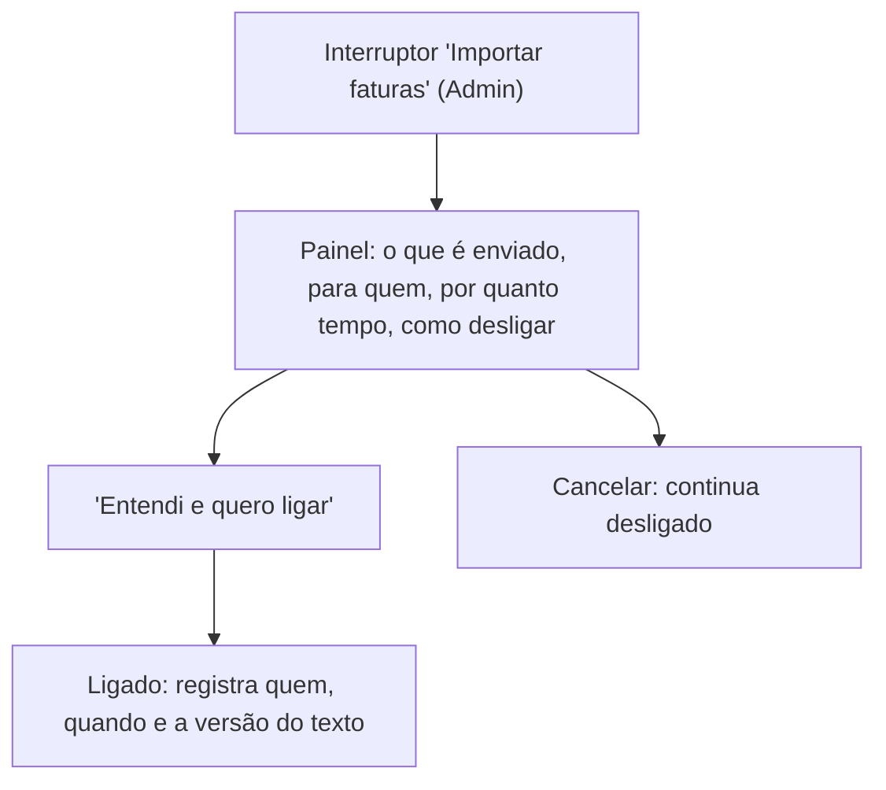

# FLUXO-016: Privacidade e consentimento para IA (R4-B/R4-D, proposta)

- **Objetivo**: garantir que **nenhum dado financeiro saia para um provedor de IA sem consentimento informado e revogável**, com o mínimo de fricção.
- **Rastreabilidade**: NEED-023, NEED-025, NEED-026, NEED-027 · [EN-005](../backlog/stories/EN-005-opt-in-de-privacidade-para-ia.md), [EN-004](../backlog/stories/EN-004-infra-llm-chave-do-app-e-teto-de-custo.md), [US-074](../backlog/stories/US-074-conceder-e-revogar-acesso-do-assistente.md) · RN15, RN16 · D-PO-58, D-PO-66.

## 1. Onde fica
**Configurações ▸ IA e privacidade** (Administrador edita; demais membros leem). Uma única tela, com três blocos:

| Bloco | Quem controla | Conteúdo |
| :-- | :-- | :-- |
| **Recursos da família** | Administrador | Interruptores separados: "Importar faturas" e "Análise de gastos" (ambos desligados). Cada um mostra, em uma frase, o que é enviado. |
| **Consumo do mês** | Administrador vê | "R$ X de R$ Y usados" (EN-004). Membro comum não vê. |
| **Meu assistente** (atalho) | Cada membro | Leva a "Assistente de IA" (MCP) com a permissão de cada um (US-074). |

## 2. Ligar um recurso

- O texto é **curto e concreto** ("O arquivo da fatura é enviado à Anthropic para leitura e depois descartado. Nada além disso sai do app"). Detalhe completo atrás de "Ver como tratamos seus dados".
- Cada recurso tem texto próprio (importação ≠ análise: a análise envia totais por categoria e valores recorrentes, sem nomes de pessoas nem dados de conta).
- Mudança de versão do texto desliga o recurso até nova confirmação do Administrador.

## 3. Acesso do assistente (MCP, por membro)
- **Assistente de IA** em Configurações: lista de credenciais (nome, escopo, validade, último uso, situação) e botão "Conectar um assistente".
- Ao conectar: aviso de privacidade diferente do das outras IAs ("os dados consultados vão ao provedor da IA que **você** usa"), escolha do nome, validade e escopo (leitura; lançamento só quando existir). A credencial aparece **uma vez** com botão copiar e instruções.
- **Atividade**: aba com o que o assistente leu e lançou (US-077), com "Revogar este assistente".
- Administrador pode **bloquear o recurso para a família**; membros veem o aviso e as credenciais deixam de funcionar.

## 4. Quando o recurso está desligado ou bloqueado
- Nas telas que usam IA (Importar fatura, Análise), a pessoa não vê erro seco: vê a explicação e, se for Administrador, um atalho para ligar; se for membro, "Peça ao Administrador".
- Teto de custo atingido: mensagem com a data em que volta a liberar; nada é enviado.
