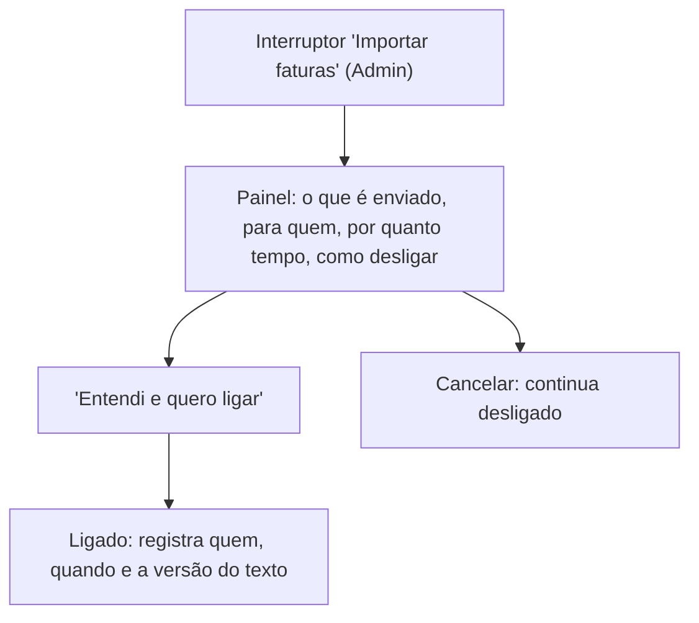
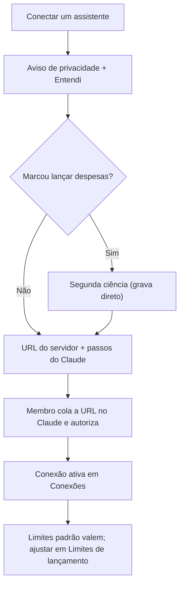

# FLUXO-016: Privacidade e consentimento para IA (R4-B/R4-D, proposta)

- **Objetivo**: garantir que **nenhum dado financeiro saia para um provedor de IA sem consentimento informado e revogável**, com o mínimo de fricção.
- **Rastreabilidade**: NEED-023, NEED-025, NEED-026, NEED-027 · [EN-005](../backlog/stories/EN-005-opt-in-de-privacidade-para-ia.md), [EN-004](../backlog/stories/EN-004-infra-llm-chave-do-app-e-teto-de-custo.md), [US-074](../backlog/stories/US-074-conceder-e-revogar-acesso-do-assistente.md) · RN15, RN16 · D-PO-58, D-PO-66, D-PO-73, D-PO-75.

## 1. Onde fica
**Configurações ▸ IA e privacidade** (Administrador edita; demais membros leem). Uma única tela, com três blocos:

| Bloco | Quem controla | Conteúdo |
| :-- | :-- | :-- |
| **Recursos da família** | Administrador | Interruptores separados: "Importar faturas" e "Análise de gastos" (ambos desligados). Cada um mostra, em uma frase, o que é enviado. |
| **Consumo do mês** | Administrador vê | "R$ X de R$ Y usados" (EN-004). Membro comum não vê. |
| **Meu assistente** (atalho) | Cada membro | Leva a "Assistente de IA" (MCP) com a permissão de cada um (US-074). |

## 2. Ligar um recurso

- O texto é **curto e concreto** ("O arquivo da fatura é enviado à Anthropic para leitura e depois descartado. Nada além disso sai do app"). Detalhe completo atrás de "Ver como tratamos seus dados".
- Cada recurso tem texto próprio (importação ≠ análise: a análise envia totais por categoria e valores recorrentes, sem nomes de pessoas nem dados de conta).
- Mudança de versão do texto desliga o recurso até nova confirmação do Administrador.

## 3. Acesso do assistente (MCP, por membro; POC com Claude)
- **Assistente de IA** em Configurações: lista de conexões (nome, permissões, validade, último uso, situação), botão "Conectar um assistente" e abas **Conexões · Limites de lançamento · Atividade**.
- **Conectar:** aviso de privacidade ("os dados consultados vão ao provedor da IA que **você** usa") com "Entendi"; nome do assistente; validade (30/90 dias); permissões: "Consultar meus dados" (marcada) e "**Lançar despesas em seu nome (sem confirmação)**" (**desmarcada**; ao marcar, aparece a **segunda ciência** "grava direto, sem pedir sua confirmação; você poderá excluir depois").
- **Sem credencial na tela (OAuth):** o app mostra a **URL do servidor** com botão copiar e os passos **só do Claude** (web, Desktop, celular e Claude Code). O membro cola a URL no Claude, que o leva a autorizar no app (a tela de autorização repete as permissões). Outros clientes: ampliação; token pessoal: US-074b.
- **Limites de lançamento** (US-076b): três campos (valor por lançamento, por dia, por hora) com os padrões R$ 500,00 / 10 / 5 e a opção "Sem limite" em cada um. Ao escolher "Sem limite": aviso "um erro ou instrução maliciosa da IA pode gerar muitos lançamentos indevidos" **e** "este app não movimenta dinheiro em bancos reais, os lançamentos só alteram os registros do app", com "Entendi o risco" para salvar.
- **Atividade**: aba com o que o assistente leu e lançou (US-077; um item por lançamento, "Bloqueado pelo seu limite", alterações de limite), com "Revogar este assistente".
- Administrador pode **bloquear o recurso para a família**; membros veem o aviso e as conexões deixam de funcionar.

## 4. Quando o recurso está desligado ou bloqueado
- Nas telas que usam IA (Importar fatura, Análise), a pessoa não vê erro seco: vê a explicação e, se for Administrador, um atalho para ligar; se for membro, "Peça ao Administrador".
- Teto de custo atingido: mensagem com a data em que volta a liberar; nada é enviado.

## 5. Histórico
- 2026-10-24 — Revisão (D-PO-72..75): OAuth sem credencial exibida, permissão de lançar com segunda ciência, tela de limites com aviso de risco.
