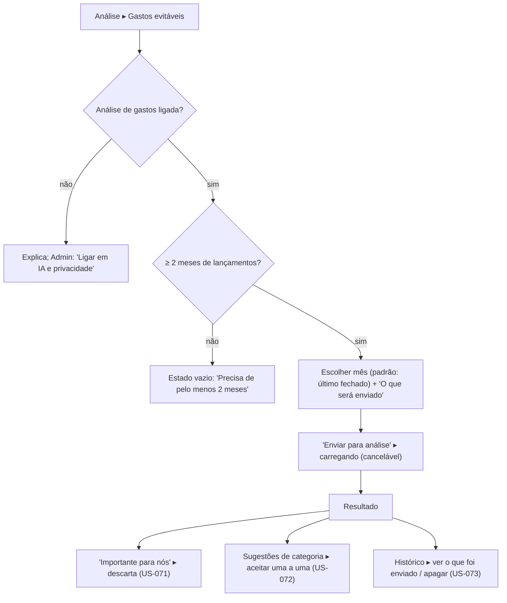

# FLUXO-017: Análise de gastos evitáveis por IA (R4-C, proposta)

- **Objetivo**: dar à família uma **segunda opinião educativa** sobre onde há margem para economizar, em linguagem simples e sem culpar ninguém, sem gravar nada por conta própria.
- **Rastreabilidade**: NEED-027 (concretiza NEED-023) · [US-070](../backlog/stories/US-070-analise-de-gastos-evitaveis.md), [US-071](../backlog/stories/US-071-descartar-sugestao-de-gasto-evitavel.md), [US-072](../backlog/stories/US-072-aceitar-sugestao-de-categoria.md), [US-073](../backlog/stories/US-073-historico-e-apagar-analises.md) · [EN-004](../backlog/stories/EN-004-infra-llm-chave-do-app-e-teto-de-custo.md), [EN-005](../backlog/stories/EN-005-opt-in-de-privacidade-para-ia.md) · D-PO-64, D-PO-65 · reaproveita FLUXO-014 §4 (visões sintéticas).

## Tela de pedido
Mês, texto "O que será enviado" (lista dos dados reais: totais por categoria dos últimos meses e valores recorrentes; **sem nomes de pessoas e sem dados de conta**), estimativa de uso e botão "Enviar para análise". Sem opção de incluir texto livre na 1ª versão.

## Tela de resultado (de cima para baixo)
1. **Resumo em 2 ou 3 frases** e a data da análise, com o selo "Gerada por IA: confira os números".
2. **Onde está a margem**: cartões de **possíveis gastos evitáveis**, cada um com nome, valor mensal e anual (calculados pelo app), o **porquê** e as ações "Importante para nós" e "Ver lançamentos" (abre o Extrato filtrado).
3. **Categorias por grupo**: Essencial / Importante / Supérfluo, cada categoria com valor, variação contra o mês anterior e uma linha explicando a classificação.
4. **Sugestões de categoria** (se houver): "Droga Raia: de Lazer para Saúde" com Aceitar / Recusar por item; nunca "aceitar todas".
5. **Rodapé fixo de texto**: "Análise educativa. Não substitui um profissional. Nenhum dado foi alterado."
- Tom: coletivo e sem julgamento ("a família gastou", nunca "Lucas gastou"). Nada de ranking entre membros.
- Valores seguem a preferência de **ocultar valores** da US-027 (ocultos até o toque).

## Estados
Carregando (esqueleto + "Analisando…", cancelável); vazio; IA desligada; teto atingido (com data); erro do provedor ("Tente novamente em instantes", nada salvo); resposta inconsistente (números divergentes do app são substituídos pelos do app).

## Histórico
Lista cronológica de análises com "O que foi enviado" por análise, apagar uma ou todas (sugestões descartadas permanecem).
