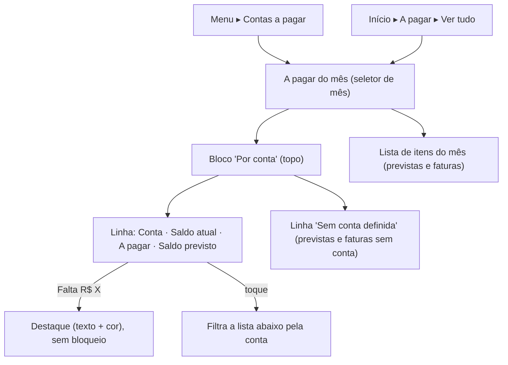

# FLUXO-018: Visão por conta em "A pagar" (saldo previsto)

- **Objetivo**: responder em 3 segundos "cada conta aguenta o mês?", antes de o vencimento chegar.
- **Personas**: Mariana (gestora da casa), Lucas (responsável por algumas contas).
- **Rastreabilidade**: [NEED-033](../../stakeholder/needs/NEED-033-visao-sintetica-por-conta-em-contas-a-pagar.md) (Q-U24) · [US-060](../backlog/stories/US-060-resumo-por-conta-no-a-pagar.md), [US-089](../backlog/stories/US-089-conta-pagadora-padrao-do-cartao.md), [US-051](../backlog/stories/US-051-receitas-previstas-e-saldo-previsto.md), [US-100](../backlog/stories/US-100-transferencia-prevista.md) · estende o [FLUXO-005](FLUXO-005-despesas-previstas.md) · D-PO-99

## 1. Diagrama

## 2. Especificação de interface
1. **Bloco "Por conta"** abaixo do seletor de mês e acima da lista; **uma linha por conta** (saldo previsto crescente: as que faltam primeiro). Colunas: **Saldo atual · A pagar · Saldo previsto**. Colunas extras **"A receber"** (US-051) e **"Transferências previstas"** (US-100) aparecem **só quando há valores**.
2. **Linha de rodapé "Total"** com a soma de "A pagar" igual ao total da tela; **"Sem conta definida"** mostra só "A pagar".
3. **Alerta**: saldo previsto negativo mostra "Falta R$ X" (cor + texto + ícone), sem bloquear nada.
4. **Interação**: tocar numa linha filtra a lista de itens daquela conta (chip "Conta: Corrente ✕"); tocar de novo ou no ✕ limpa.
5. **Fatura de cartão** entra na conta pagadora padrão do cartão (US-089); sem ela, em "Sem conta definida".
6. **Mobile (375 px)**: cada conta vira um cartão (nome + três valores rotulados), sem rolagem horizontal; **desktop**: tabela. Ocultar valores (US-027) mascara tudo.
7. **Estados**: skeleton, vazio ("Nada a pagar neste mês"; contas com saldo continuam listadas), erro com "Tentar de novo".

## 3. Regras de leitura
Saldo previsto é derivado e **nunca grava**; inclui previstas "Só meu" de outro membro (todos já veem). Mês futuro: saldo atual menos só os vencimentos daquele mês (D-PO-42).

## 4. Histórico
- 2026-10-26 — Criado no refinamento da US-060 (uso real).
